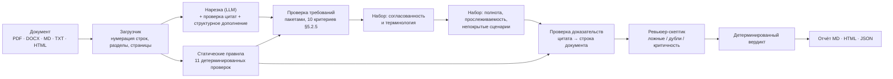

# ReqLens — ИИ-агент статической проверки требований

**BCC-HUB × MNU FinTech Hackathon · Агент проверки требований**

ReqLens читает документ с требованиями (PDF, DOCX, Markdown, TXT, HTML) и проверяет его до начала разработки.
Он делит документ на отдельные требования, оценивает каждое по ISO/IEC/IEEE 29148:2018 (п. 5.2.5, 5.2.6)
и IEEE Std 830-1998 (п. 4.3), затем проверяет набор целиком. Результат — отчёт на русском: доказательства с номерами строк,
рекомендации по исправлению, **уточняющие вопросы к бизнесу, аналитику и архитектору** и вердикт, можно ли начинать
разработку и тестирование.

```bash
python main.py examples/requirements.md reports/report.md
```

---

## Чем ReqLens отличается

| | Как устроено |
| :--- | :--- |
| **Ноль выдуманных замечаний** | Каждая цитата, которую вернула модель, ищется в документе кодом (точно, по фрагментам или нечётко). Замечание без подтверждённой цитаты отбрасывается и попадает в журнал. Номер строки ставит код, а не модель. |
| **Гибрид правил и LLM** | 11 детерминированных правил ловят типовые дефекты без модели: GET для изменения данных, ошибку под HTTP 200, тиыны против тенге, разные типы полей, заглушки, пустые поля. LLM ищет смысловые дефекты: противоречия правил и примеров, пропущенные сценарии, неопределённые термины. |
| **Ревьюер-скептик** | Отдельный проход модели убирает ложные срабатывания, объединяет дубли и калибрует критичность. |
| **Вопросы, а не общие фразы** | У каждого дефекта есть конкретный уточняющий вопрос с адресатом (бизнес, аналитик, архитектор, QA, ИБ). Вопросы собраны в отдельный раздел отчёта. |
| **Готовые критерии приёмки** | Для непокрытых сценариев агент предлагает критерии «Дано / Когда / Тогда» с числами: их можно сразу вставить в ТЗ. |
| **Вердикт нельзя «уговорить»** | Решение «можно / условно / нельзя» вычисляется по критичности найденных дефектов. Модель пишет только обоснование. |
| **Работает на бесплатном тарифе** | Пакетная проверка (~9 запросов за прогон), автоматический переход на запасную модель при исчерпании квоты, повторы при 429, кэш ответов: повторный прогон бесплатен и мгновенен. |
| **Ноль тяжёлых зависимостей** | HTTP-клиенты Gemini, OpenAI и Anthropic, чтение DOCX и HTML, валидация JSON написаны на стандартной библиотеке. Ставятся только `pypdf`, `markdown`, `certifi`. |

---

## Быстрый старт

### 1. Установка (Python 3.9+)

```bash
git clone <ссылка на этот репозиторий>
cd reqlens
python -m venv .venv
# Windows: .venv\Scripts\activate    macOS/Linux: source .venv/bin/activate
pip install -r requirements.txt
```

### 2. Ключ LLM (бесплатно)

1. Откройте [Google AI Studio](https://aistudio.google.com/) и войдите Google-аккаунтом.
2. Нажмите **Get API key → Create API key** и скопируйте ключ.
3. Создайте файл `.env` из примера и вставьте ключ:

```bash
cp .env.example .env          # Windows: copy .env.example .env
```

```dotenv
GEMINI_API_KEY=ваш_ключ
GEMINI_MODEL=gemini-3.5-flash
```

Ключ хранится только в `.env`. Этот файл исключён из git (`.gitignore`), в репозитории лежит только `.env.example` без ключа.

### 3. Запуск прогона — одна команда

```bash
python main.py <путь к документу требований> <путь к файлу отчёта>

# прогон на документе организаторов:
python main.py examples/requirements.md reports/report.md
```

### 4. Куда ложится отчёт

| Файл | Назначение |
| :--- | :--- |
| `reports/report.md` | основной отчёт (Markdown, русский язык) |
| `reports/report.html` | та же версия для браузера: навигация, таблицы, тёмная тема |
| `reports/report.json` | машиночитаемый результат (для CI, Jira, дашбордов) |
| `reports/report_questions.md` | опросник для заинтересованных сторон: вопросы по адресатам с местом для ответов — можно сразу отправить бизнесу, архитектору, ИБ |

Если путь к отчёту не указан, отчёт ляжет в `reports/<имя_документа>_report.md`.

Пример вывода в консоли:

```text
ReqLens 1.0.0 — статическая проверка требований
Модель: gemini-3.5-flash · Google Gemini API (запасные: gemini-3-flash-preview, gemini-3.1-flash-lite, gemini-2.5-flash)
[1/7] Чтение документа: examples/requirements.md
      Markdown, 198 строк, «Уведомление о расходах по карте»
[2/7] Статические правила
[3/7] Нарезка на требования
[4/7] Проверка каждого требования
      пакет 1/5: REQ-01…REQ-10
      …
[5/7] Проверка набора: согласованность и терминология
[6/7] Ревью находок (скептик)
[7/7] Формирование отчёта
Разработка: ⛔ Нельзя начинать · Тестирование: ⛔ Нельзя начинать
Отчёт: reports/report.md
```

> Перед финальным прогоном закоммитьте код: в паспорт отчёта попадёт commit агента, и прогон можно будет воспроизвести.

---

## Что в отчёте

Структура совпадает с составом отчёта из ТЗ хакатона:

1. **Паспорт прогона.** Документ, SHA-256, дата и время, модель (и запасная, если сработала), версия агента (тег и commit), длительность, число вызовов LLM и токенов.
2. **Как агент нарезал требования.** Таблица «ID в отчёте — ID в документе — раздел — строки — тип — краткая формулировка — цитата». Требованиям без номера агент присваивает свой ID и сохраняет цитату. Указана доля покрытия текста документа.
3. **Проверка каждого требования.** Матрица «требование × 10 критериев» (✅/🟢/🟡/🔴) и разбор по каждому требованию. У каждого дефекта есть цитата с номером строки, суть проблемы и последствие, исправленная формулировка, уточняющий вопрос и тест-идея.
4. **Проверка набора целиком.** 8 свойств ISO 29148 §5.2.6 и IEEE 830 §4.3: полнота, непротиворечивость, реализуемость, понятность (таблица терминов-синонимов), возможность валидации, прослеживаемость (матрица «функция → UI → API → данные → приёмка»), ранжированность, модифицируемость. Плюс непокрытые сценарии с готовыми критериями приёмки.
5. **Сводка.** Число требований и нарушений, распределение по критичности и критериям, список критичных дефектов, сгруппированный на противоречивые, непроверяемые и неполные формулировки.
6. **Итог.** Отдельные вердикты для разработки и для тестирования с обоснованием, «что исправить в первую очередь», критерий готовности документа.
7. **Вопросы для уточнения**, сгруппированные по адресатам.
8. **Приложения.** Методика, критерии, шкала критичности, статистика проверки доказательств (сколько цитат подтверждено и отклонено, сколько находок удалено), журнал этапов.

---

## Архитектура



| Модуль | Ответственность |
| :--- | :--- |
| `reqlens/loaders.py` | Чтение PDF (pypdf → pdfminer), DOCX и HTML (стандартная библиотека), TXT/MD (UTF-8, CP1251). Структура переводится в Markdown. |
| `reqlens/document.py` | Модель документа: строки, разделы, страницы. Нормализация и поиск цитат (точный, по фрагментам с «…», нечёткий). |
| `reqlens/rules.py` | Детерминированные правила с готовыми объяснениями, рекомендациями и вопросами. |
| `reqlens/segmenter.py` | Проверка нарезки модели по тексту, структурная нарезка (офлайн и дополнение пропусков), покрытие. |
| `reqlens/prompts/` | Промпты этапов: критерии, шкала критичности, эвристики финтех-домена, правила доказательности. |
| `reqlens/schemas.py` | JSON Schema ответов. Одна и та же схема уходит в модель (structured output) и проверяет её ответ. |
| `reqlens/llm/` | Провайдеры Gemini / OpenAI-совместимые / Anthropic / Ollama на `urllib`; ретраи, запасные модели, кэш, ремонт JSON. |
| `reqlens/pipeline.py` | Оркестрация этапов, привязка находок к требованиям, склейка дублей, применение решений ревьюера. |
| `reqlens/verdict.py` | Вердикт и приоритеты. |
| `reqlens/report_md.py`, `report_export.py` | Отчёт в Markdown, HTML и JSON. |

### Надёжность прогона

| Ситуация | Что делает агент |
| :--- | :--- |
| 429, лимит в минуту | Ждёт столько, сколько просит API (`retryDelay`), и повторяет запрос |
| Кончилась дневная квота бесплатного тарифа / модель не найдена | Переходит на следующую модель из `GEMINI_FALLBACK_MODELS` и пишет её в паспорт |
| 5xx, сеть, таймаут | Экспоненциальная пауза, до `LLM_MAX_RETRIES` повторов, затем запасная модель |
| API не принимает формат structured output | Автоматически переходит на другой формат (`responseFormat` → `responseJsonSchema` → `responseMimeType`) |
| Модель вернула не JSON или JSON не по схеме | Повторный запрос с описанием ошибки (до 2 раз); невалидные элементы отфильтровываются |
| Ответ обрезан по лимиту токенов | Пакет требований делится пополам и проверяется по частям |
| Модель пропустила часть требований | Дозапрос по пропущенным; при неполной нарезке пропуски добавляются структурной нарезкой |
| Сбой одного этапа | Прогон продолжается, сбой фиксируется в отчёте. Завершённые этапы лежат в кэше, повторный запуск продолжит с места сбоя |
| Неверный ключ / регион не поддерживается | Понятное сообщение и код выхода 3 |

---

## Критерии проверки

| Уровень | Критерии | Стандарт |
| :--- | :--- | :--- |
| Отдельное требование | необходимость, уместность (без лишних проектных решений), однозначность, полнота, атомарность, реализуемость, проверяемость, корректность, соответствие стандартам | ISO/IEC/IEEE 29148:2018 §5.2.5 |
| | непротиворечивость | IEEE 830 §4.3.4 |
| Набор требований | полнота, непротиворечивость, реализуемость, понятность, возможность валидации | ISO/IEC/IEEE 29148:2018 §5.2.6 |
| | прослеживаемость, ранжированность, модифицируемость | IEEE 830 §4.3.5, §4.3.7, §4.3.8 |

Шкала критичности:
- 🔴 **критичный** — блокирует разработку или тестирование;
- 🟡 **существенный** — уточнить до спринта;
- 🟢 **замечание** — исправить в рабочем порядке.

---

## Параметры командной строки

```text
python main.py INPUT [OUTPUT] [опции]

  -i/--input, -o/--output   альтернатива позиционным аргументам
  --provider                gemini | openai | anthropic | ollama (по умолчанию — по ключу в .env)
  --model                   модель, например gemini-3-flash-preview
  --offline                 без LLM: статические правила и структурная нарезка (для CI и проверки без ключа)
  --batch-size N            требований в одном запросе (по умолчанию 10; больше — меньше запросов)
  --no-cache                не использовать кэш ответов модели
  --no-review               пропустить проход ревьюера-скептика
  --no-html                 не создавать HTML-версию
  --fail-on critical|major  код выхода 2 при дефектах этого уровня (quality gate в CI)
  -v / -q                   подробный журнал / без прогресса
```

Коды выхода: `0` — отчёт сформирован; `1` — неверные аргументы; `2` — ошибка входного файла или настройки (или сработал `--fail-on`); `3` — нет доступа к модели.

## Модели и провайдеры

| Провайдер | Настройка в `.env` | Примечание |
| :--- | :--- | :--- |
| **Google Gemini** (по умолчанию) | `GEMINI_API_KEY`, `GEMINI_MODEL=gemini-3.5-flash` | бесплатный тариф AI Studio; запасные: `gemini-3-flash-preview`, `gemini-3.1-flash-lite`, `gemini-2.5-flash` |
| OpenAI и совместимые | `LLM_PROVIDER=openai`, `OPENAI_API_KEY`, `OPENAI_MODEL`, `OPENAI_BASE_URL` | DeepSeek, OpenRouter, Groq, vLLM, LM Studio |
| Anthropic | `LLM_PROVIDER=anthropic`, `ANTHROPIC_API_KEY`, `ANTHROPIC_MODEL` | |
| Ollama (локально, без ключа) | `LLM_PROVIDER=ollama`, `OLLAMA_MODEL` | качество зависит от размера модели |

Модель, на которой сформирован сданный отчёт, указана в его паспорте.

## Тесты

```bash
pip install -r requirements-dev.txt
python -m pytest -q
```

45 тестов без сети и ключей:
- загрузчики всех форматов;
- поиск цитат и отклонение выдуманных;
- правила на документе организаторов;
- JSON-валидатор;
- ретраи, запасные модели, кэш, ремонт JSON, обрезанные ответы;
- маппинг ошибок Gemini;
- реальный HTTP-путь через локальный сервер, имитирующий Gemini, OpenAI и Anthropic;
- сквозной прогон с фейковой моделью, которая присылает битый JSON, 429, обрезанные ответы и выдуманные цитаты.

CI (GitHub Actions) гоняет тесты на Python 3.9 и 3.12 и делает офлайн-прогон на документе организаторов.

## Docker

```bash
docker build -t reqlens .
docker run --rm --env-file .env -v "$(pwd)/reports:/app/reports" reqlens examples/requirements.md reports/report.md
```

## Структура репозитория

```text
main.py                 точка входа (одна команда)
reqlens/                код агента
tests/                  тесты, фейковая модель, локальный HTTP-сервер
examples/requirements.md  копия выданного документа — для воспроизведения прогона
reports/                отчёты, сформированные агентом
docs/DEMO.md            сценарий демонстрации и защиты
.env.example            пример конфигурации без ключа
```

## Ограничения

- Агент проверяет текст требований, а не работающую программу. Он не заменяет ревью экспертом, а готовит его: сужает до конкретных вопросов.
- Из PDF без текстового слоя (скан) нужно сначала извлечь текст через OCR.
- Модель стохастична. Повторяемость обеспечивают кэш ответов, проверка цитат кодом и детерминированный вердикт.
